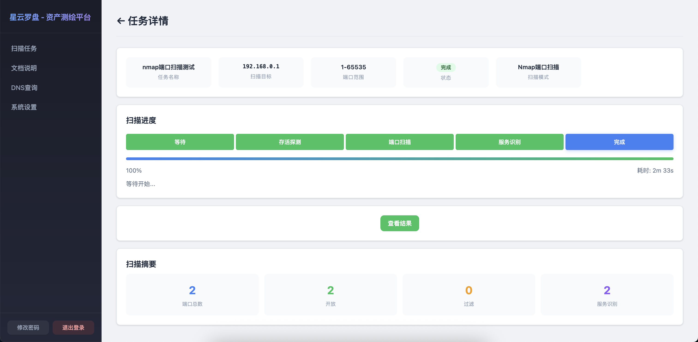
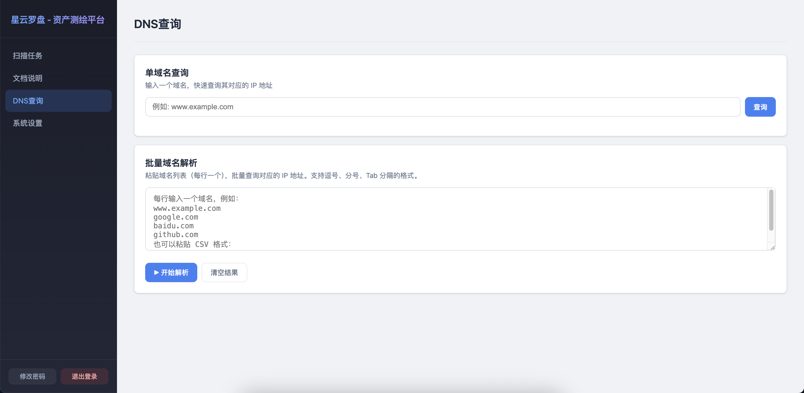
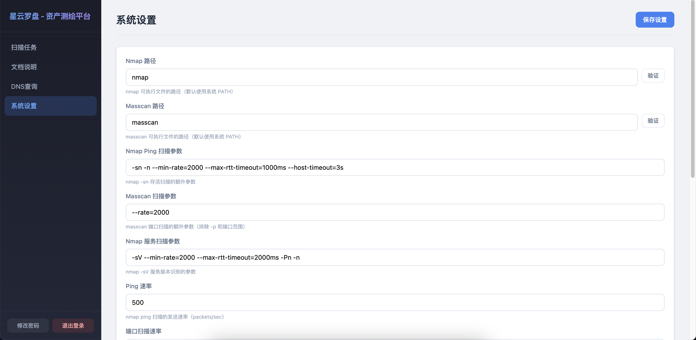

# 星云罗盘 - 资产测绘平台

**NebulaCompass** — 一个基于 Web 的内外网资产探测与端口扫描管理平台。

星云罗盘整合了 **Nmap** 和 **Masscan** 两款经典网络扫描工具，提供从存活探测、端口扫描到服务版本识别的全流程可视化能力，并通过 Web Dashboard 让扫描任务的创建、执行与结果分析变得简单高效。

---

## 特性

- **多种扫描模式（严格隔离）** — 全套扫描、存活探测、端口扫描、服务识别、Nmap 端口扫描；每种模式只执行自己定义的动作，不会串跑其它阶段
- **预置端口列表** — 除自定义端口外，可勾选「常见 100 端口 / 常见 WEB 端口 / 常见约 1200 端口 / 数据库与 MQ 端口 / 常见 UDP 端口」，按「常用 / 专项」分组展示，支持全选 / 清空并实时显示「已选 N 项 · 约 X 个端口」，与自定义端口自动合并去重
- **端口扫描实时预估** — 端口扫描阶段实时展示 masscan 自带进度百分比、预估剩余时间与 kpps 速率（任务列表 / 任务详情 / 实时输出三处同步）
- **暂停与断点续扫** — 运行中的任务可暂停，已完成的阶段（存活主机、已完成服务识别的主机）记录为断点，点击「继续扫描」从断点续跑。
  端口扫描阶段因 masscan 无 checkpoint 不支持精确断点，续跑会重新执行该阶段，但**已发现的端口会保留**，界面会明确提示
- **过程结果存档** — 运行中 / 暂停 / 取消 / 失败的任务都能导出：XLSX、CSV、JSON，或完整过程存档 ZIP（结果 + 原始 XML/端口输出 + 命令记录 + 过程日志）；重新扫描与删除前会自动存档到 `ExportResults/history/`
- **双引擎驱动** — Nmap 负责存活探测与服务版本识别，Masscan 负责高速端口扫描
- **实时进度推送** — 基于 SSE（Server-Sent Events），浏览器实时展示任务进度、阶段切换与命令行输出
- **Web Dashboard** — 任务管理、结果浏览、搜索过滤、数据导出一站完成
- **DNS 查询工具** — 内置批量 DNS 解析功能，支持导出 CSV
- **多格式导出** — 扫描结果一键导出为结构化 XLSX / CSV / JSON，包含端口汇总、存活主机与主机端口概览
- **CSV 目标导入** — 支持从 CSV 或文本文件批量导入扫描目标
- **结果搜索** — 对扫描结果按 IP、服务、产品、版本进行实时搜索
- **OS 识别** — 自动汇总扫描结果的指纹及操作系统信息
- **可配置参数** — 完整暴露 nmap/masscan 的扫描参数，在设置面板中随时调整
- **会话认证** — 内置 Session 鉴权，默认管理员账户，开箱即安全
- **命令追溯** — 自动记录每次扫描实际执行的完整命令行，便于审计与复现
- **数据持久化** — 基于 SQLite 存储所有任务与结果，重启不丢失

---

## 截图

> *任务列表与创建扫描任务入口*


> *扫描任务实时进度 — 三阶段流水线与命令行输出*



> *扫描结果详情与端口/服务汇总*


> *DNS 批量查询工具*



> *系统设置面板 — 配置工具路径与扫描参数*



---

## 快速开始

### 前置依赖

星云罗盘本身是独立的 Go 应用，但扫描功能依赖系统中已安装 **nmap** 和 **masscan**。

- **Go** 1.25+（如需从源码编译）
- **Nmap** 7.x — [下载地址](https://nmap.org/download.html)
- **Masscan** 1.x — [GitHub](https://github.com/robertdavidgraham/masscan)

#### 安装 nmap

```bash
# macOS
brew install nmap

# Debian / Ubuntu
sudo apt install nmap -y

# CentOS / RHEL
sudo yum install nmap -y
```

#### 安装 masscan

```bash
# macOS
brew install masscan

# Debian / Ubuntu
sudo apt install masscan -y

# 从源码编译（推荐，获取最新版本）
git clone https://github.com/robertdavidgraham/masscan.git
cd masscan
make -j$(nproc)
sudo make install
```

> **权限提示**：`masscan` 需要原始套接字权限，**以 root 运行**才能进行「全套扫描 / 端口扫描」。
> 普通用户启动时程序会在控制台给出警告，且这两个模式会失败；此时可改用「Nmap 端口扫描」模式（自动 `-sS → -sT`）。

### 启动服务

```bash
# 从源码构建（模板与静态资源已内嵌，产物可直接拷到任意目录运行）
go build -o nebula-compass .

# 直接运行（默认端口 8080）
./nebula-compass

# 指定端口
./nebula-compass -p 9090

# 需要端口扫描（masscan）时
sudo ./nebula-compass
```

首次启动后，打开浏览器访问 **http://localhost:8080**，使用默认账号登录：

| 用户名 | 密码 |
|--------|------|
| admin  | admin123 |

**登录后请立即修改默认密码。**

---

## 使用指南

### 扫描模式

| 模式 | 说明 |
|------|------|
| **全套扫描** | 默认模式。依次执行存活探测（Ping）→ Masscan 端口扫描 → Nmap 服务版本识别 |
| **存活探测** | 仅通过 ICMP Ping 或 ARP 探测目标网段中在线的设备 |
| **端口扫描** | 存活探测 + Masscan 高速端口扫描，不进行服务识别 |
| **服务识别** | 跳过存活探测与端口扫描，只对目标里写明的 `IP:端口` 执行 Nmap 服务版本识别（不使用端口范围/预置端口列表） |
| **Nmap 端口扫描** | 使用 Nmap 替代 Masscan 进行端口扫描，适合精度要求更高的场景 |

### 扫描目标格式

支持每行一个目标，混合使用：

```
192.168.1.0/24
10.0.0.1
172.16.0.0/16
example.com
```

服务识别模式下**只扫描目标里写明的端口**，目标必须是 `IP:端口`（或 `域名:端口`）格式，该模式不提供「端口范围 / 预置端口列表」：

```
192.168.1.1:80
192.168.1.1:443
10.0.0.2:22
example.com:443
```

同一 IP 的多个端口写成多行即可（`10.0.0.2:22` / `10.0.0.2:80` 会自动合并为一次 nmap 调用）。
纯 IP、CIDR 网段会被拒绝并提示具体是哪几条缺端口——服务识别不猜端口，避免后台悄悄扫出你没写过的端口。

### 结果查看

- **任务列表** — 概览所有扫描任务的状态、进度与耗时（带图标与清空按钮的搜索框，按名称/目标/状态实时过滤，匹配数量即时提示；每页 20 条）
- **任务详情** — 实时查看扫描输出、阶段切换与命令行记录；页头显示自动刷新状态与最近同步时间，绿色圆点即表示正在自动对齐
- **详情自动刷新** — SSE 推送 + 自适应轮询（进行中 2 秒、空闲 12 秒）；进入页面、标签页切回前台、浏览器前进/后退（含 bfcache 恢复）都会立即按最新数据重载，不会停留在上一次的进度
- **进度文案** — 进度卡片右上角由最新快照推导：等待开始 → 正在启动扫描 → 正在执行：X 阶段 → 扫描完成 / 已暂停 / 已取消 / 扫描失败
- **超长内容回缩** — 「扫描目标」「端口范围」超过两行自动回缩，点「展开全部 / 收起」切换
- **结果页** — 按 IP 和端口排序展示所有开放端口，支持搜索过滤
- **服务汇总** — 自动统计扫描到的服务类型及其数量
- **OS 指纹** — 服务识别阶段从 nmap `-sV` 的 `ostype` 与 `osmatch` 中提取操作系统线索并汇总（无需 `-O` 权限；如需更精确可在服务扫描参数中追加 `-O`）
- **重新扫描** — 已完成/失败/取消的任务都可一键重新扫描，旧结果会先自动存档
- **多格式导出** — XLSX / CSV / JSON / 完整存档 ZIP；中文任务名使用 RFC 5987 编码，不再出现乱码文件名
- **导出完整性** — 暂停 / 取消 / 失败的任务同样保留已扫描到的端口（含端口扫描阶段中断时已发现的端口）

### DNS 查询

支持批量域名解析，输入多个域名（每行一个）即可一次性查询 A 记录。结果可导出为 CSV 文件。

---

## 配置

在"系统设置"页面可调整以下参数：

| 设置项 | 说明 |
|--------|------|
| Nmap 路径 | nmap 可执行文件路径（默认使用系统 PATH） |
| Masscan 路径 | masscan 可执行文件路径（默认使用系统 PATH） |
| Nmap Ping 扫描参数 | `nmap -sn` 存活扫描的额外参数 |
| Masscan 扫描参数 | Masscan 端口扫描参数（排除 `-p` 和端口范围） |
| Nmap 服务扫描参数 | `nmap -sV` 服务版本识别的参数 |
| Nmap 端口扫描参数 | Nmap 端口扫描模式的额外参数（默认 `-sS`，非 root 自动退化为 `-sT`） |
| 首页自动刷新间隔 | 任务列表页自动刷新时间（秒，0-86400），0 表示不自动刷新 |

设置页面的"验证"按钮可即时检查工具路径是否正确；保存时只接受上表中的配置项，非法数值会被拒绝。

---

## 从源码构建

```bash
git clone https://github.com/YOUR_USERNAME/NebulaCompass.git
cd NebulaCompass
go build -o nebula-compass .
./nebula-compass
```

依赖管理使用 Go Modules，无需额外处理。

---

## 技术栈

- **后端** — Go 1.25+（标准库 + net/http + modernc.org/sqlite）
- **前端** — 原生 HTML / CSS / JavaScript（无框架依赖）
- **数据库** — SQLite（通过 modernc.org/sqlite 纯 Go 实现，无需 CGO）
- **扫描引擎** — Nmap + Masscan（作为外部进程调用）
- **实时通信** — Server-Sent Events（SSE）
- **导出** — excelize（XLSX）

---

## 数据目录

所有数据默认存储在 `./Data_folder/` 目录下的 SQLite 数据库文件中：

```
Data_folder/
├── NebulaCompass.db          # 主数据库（任务、结果、设置、会话）
├── NebulaCompass.db-wal      # SQLite WAL 日志
└── NebulaCompass.db-shm      # SQLite 共享内存
```

> 过程日志 `scan_log` 上限 512KB、`port_scan_output` / `service_output` 上限 4MB，超出时保留尾部并在导出文件中标注截断。

导出文件默认存储在 `./ExportResults/` 目录。

---

## 注意事项

- 扫描内网或外部目标前，请确保已获得合法授权。未经授权的扫描可能违反相关法律法规。
- Masscan 的高速扫描可能被网络设备检测并拦截，必要时降低 `--rate` 参数值。
- 默认监听端口为 8080，可通过 `-p` 参数修改。
- 首次启动后会自动创建默认管理员账户，请立即修改密码（新密码至少 8 位，弱口令会被拒绝）。
- 登录会话保存在数据库中（`sessions` 表），服务重启后无需重新登录；改密会使其它会话立即失效。
- 登录接口对同一来源 IP + 用户名连续失败 5 次后锁定 60 秒。

---

## 许可证

[MIT License](LICENSE)

---

**星云罗盘** — 让资产测绘，像导航一样清晰。
