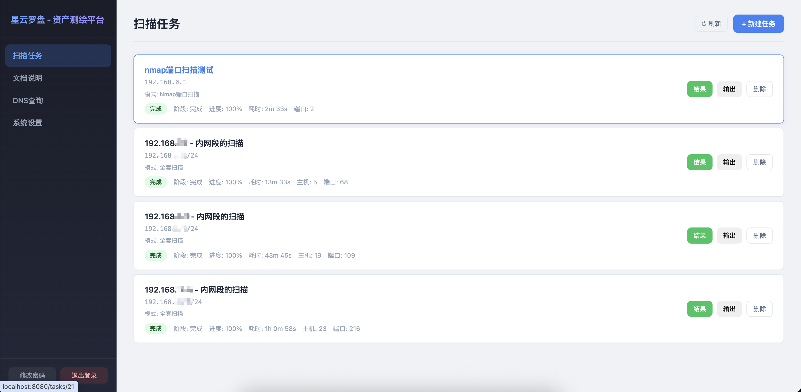
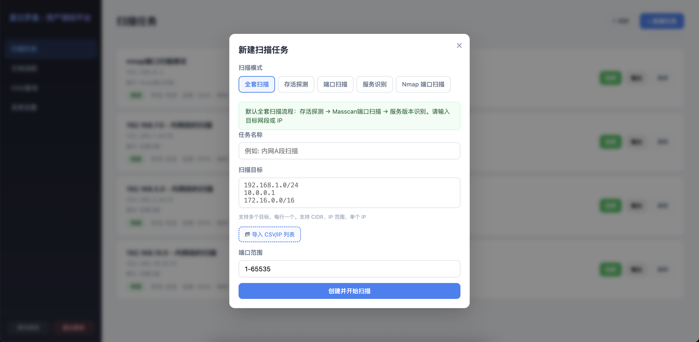
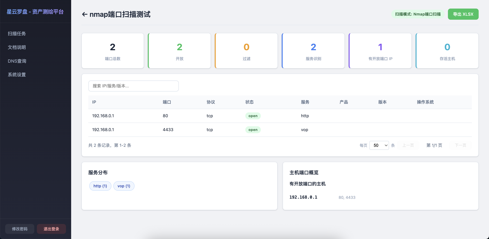

# 星云罗盘 - 资产测绘平台

**NebulaCompass** — 一个基于 Web 的内外网资产探测与端口扫描管理平台。

星云罗盘整合了 **Nmap** 和 **Masscan** 两款经典网络扫描工具，提供从存活探测、端口扫描到服务版本识别的全流程可视化能力，并通过 Web Dashboard 让扫描任务的创建、执行与结果分析变得简单高效。

---

## 特性

- **多种扫描模式** — 全套扫描、存活探测、端口扫描、服务识别、Nmap 端口扫描，灵活覆盖不同场景
- **双引擎驱动** — Nmap 负责存活探测与服务版本识别，Masscan 负责高速端口扫描
- **实时进度推送** — 基于 SSE（Server-Sent Events），浏览器实时展示任务进度、阶段切换与命令行输出
- **Web Dashboard** — 任务管理、结果浏览、搜索过滤、数据导出一站完成
- **DNS 查询工具** — 内置批量 DNS 解析功能，支持导出 CSV
- **Excel 导出** — 扫描结果一键导出为结构化 XLSX 文件，包含端口汇总与服务详情
- **CSV 目标导入** — 支持从 CSV 或文本文件批量导入扫描目标
- **结果搜索** — 对扫描结果按 IP、服务、产品、版本进行实时搜索
- **OS 识别** — 自动汇总扫描结果的指纹及操作系统信息
- **可配置参数** — 完整暴露 nmap/masscan 的扫描参数，在设置面板中随时调整
- **会话认证** — 内置 Session 鉴权，默认管理员账户，开箱即安全
- **命令追溯** — 自动记录每次扫描实际执行的完整命令行，便于审计与复现
- **数据持久化** — 基于 SQLite 存储所有任务与结果，重启不丢失

---

## 截图

> *任务列表与创建扫描任务入口*





> *扫描任务实时进度 — 三阶段流水线与命令行输出*


> *扫描结果详情与端口/服务汇总*



> *DNS 批量查询工具*


> *系统设置面板 — 配置工具路径与扫描参数*


---

## 快速开始

### 前置依赖

星云罗盘本身是独立的 Go 应用，但扫描功能依赖系统中已安装 **nmap** 和 **masscan**。

- **Go** 1.25+（如需从源码编译）
- **Nmap** 7.x — [下载地址](https://nmap.org/download.html)
- **Masscan** 1.x — [GitHub](https://github.com/robertdavidgraham/masscan)

#### 安装 nmap

```bash
# macOS
brew install nmap

# Debian / Ubuntu
sudo apt install nmap -y

# CentOS / RHEL
sudo yum install nmap -y
```

#### 安装 masscan

```bash
# macOS
brew install masscan

# Debian / Ubuntu
sudo apt install masscan -y

# 从源码编译（推荐，获取最新版本）
git clone https://github.com/robertdavidgraham/masscan.git
cd masscan
make -j$(nproc)
sudo make install
```

### 启动服务

```bash
# 从源码构建
go build -o nebula-compass .

# 直接运行（默认端口 8080）
./nebula-compass

# 指定端口
./nebula-compass -p 9090
```

首次启动后，打开浏览器访问 **http://localhost:8080**，使用默认账号登录：

| 用户名 | 密码 |
|--------|------|
| admin  | admin123 |

**登录后请立即修改默认密码。**

---

## 使用指南

### 扫描模式

| 模式 | 说明 |
|------|------|
| **全套扫描** | 默认模式。依次执行存活探测（Ping）→ Masscan 端口扫描 → Nmap 服务版本识别 |
| **存活探测** | 仅通过 ICMP Ping 或 ARP 探测目标网段中在线的设备 |
| **端口扫描** | 存活探测 + Masscan 高速端口扫描，不进行服务识别 |
| **服务识别** | 跳过存活探测，直接对指定的 `IP:端口` 列表执行 Nmap 服务版本识别 |
| **Nmap 端口扫描** | 使用 Nmap 替代 Masscan 进行端口扫描，适合精度要求更高的场景 |

### 扫描目标格式

支持每行一个目标，混合使用：

```
192.168.1.0/24
10.0.0.1
172.16.0.0/16
example.com
```

服务识别模式下目标需为 `IP:端口` 格式：

```
192.168.1.1:80
192.168.1.1:443
10.0.0.2:22
```

### 结果查看

- **任务列表** — 概览所有扫描任务的状态、进度与耗时
- **任务详情** — 实时查看扫描输出、阶段切换与命令行记录
- **结果页** — 按 IP 和端口排序展示所有开放端口，支持搜索过滤
- **服务汇总** — 自动统计扫描到的服务类型及其数量
- **OS 汇总** — 自动统计扫描到的主机操作系统信息
- **Excel 导出** — 一键下载包含端口汇总与存活主机列表的 XLSX 文件

### DNS 查询

支持批量域名解析，输入多个域名（每行一个）即可一次性查询 A 记录。结果可导出为 CSV 文件。

---

## 配置

在"系统设置"页面可调整以下参数：

| 设置项 | 说明 |
|--------|------|
| Nmap 路径 | nmap 可执行文件路径（默认使用系统 PATH） |
| Masscan 路径 | masscan 可执行文件路径（默认使用系统 PATH） |
| Nmap Ping 扫描参数 | `nmap -sn` 存活扫描的额外参数 |
| Masscan 扫描参数 | Masscan 端口扫描参数（排除 `-p` 和端口范围） |
| Nmap 服务扫描参数 | `nmap -sV` 服务版本识别的参数 |
| Ping 速率 | Ping 扫描发送速率（packets/sec） |
| 端口扫描速率 | Masscan 端口扫描速率（packets/sec） |
| 最大并发任务数 | 同时运行的最大扫描任务数 |
| 首页自动刷新间隔 | 任务列表页自动刷新时间（秒），0 表示不自动刷新 |

设置页面的"验证"按钮可即时检查工具路径是否正确。

---

## 从源码构建

```bash
git clone https://github.com/YOUR_USERNAME/NebulaCompass.git
cd NebulaCompass
go build -o nebula-compass .
./nebula-compass
```

依赖管理使用 Go Modules，无需额外处理。

---

## 技术栈

- **后端** — Go 1.25+（标准库 + net/http + modernc.org/sqlite）
- **前端** — 原生 HTML / CSS / JavaScript（无框架依赖）
- **数据库** — SQLite（通过 modernc.org/sqlite 纯 Go 实现，无需 CGO）
- **扫描引擎** — Nmap + Masscan（作为外部进程调用）
- **实时通信** — Server-Sent Events（SSE）
- **导出** — excelize（XLSX）

---

## 数据目录

所有数据默认存储在 `./Data_folder/` 目录下的 SQLite 数据库文件中：

```
Data_folder/
├── NebulaCompass.db          # 主数据库
├── NebulaCompass.db-wal      # SQLite WAL 日志
└── NebulaCompass.db-shm      # SQLite 共享内存
```

导出文件默认存储在 `./ExportResults/` 目录。

---

## 注意事项

- 扫描内网或外部目标前，请确保已获得合法授权。未经授权的扫描可能违反相关法律法规。
- Masscan 的高速扫描可能被网络设备检测并拦截，必要时降低 `--rate` 参数值。
- 默认监听端口为 8080，可通过 `-p` 参数修改。
- 首次启动后会自动创建默认管理员账户，请立即修改密码。

---

## 许可证

[MIT License](LICENSE)

---

**星云罗盘** — 让资产测绘，像导航一样清晰。
